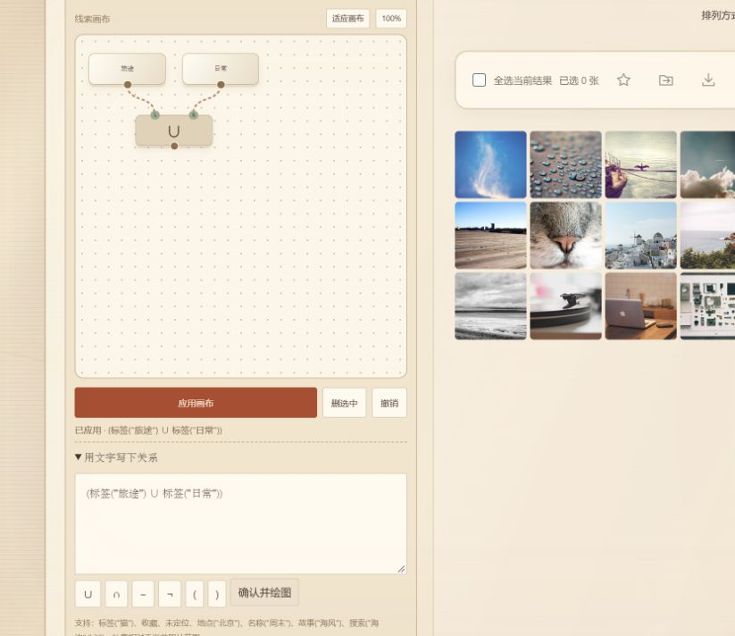
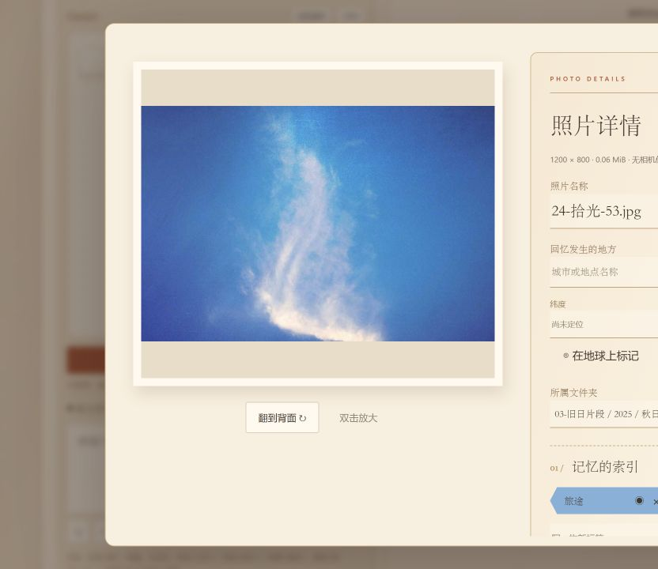
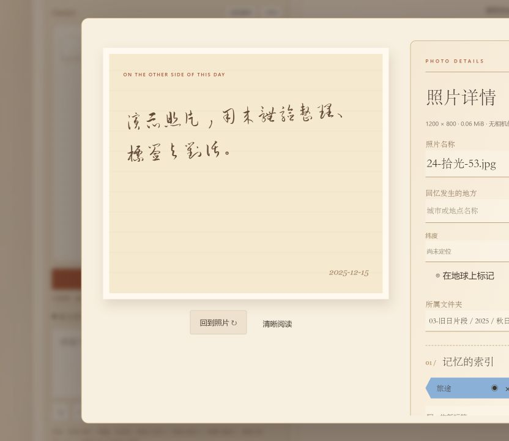
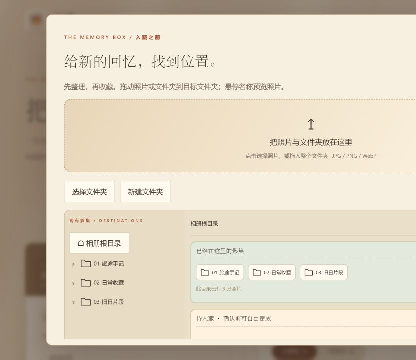

# AIbum · 拾光记忆相册

面向每人约 500 张照片的本地智慧相册：中文文搜图、图搜图、自动标签、多级影集、时光轴、照片故事、音乐与可视化条件筛选。前端采用暖纸色、相纸、手写故事和轻柔动效。

比赛截止日期为 **2026-11-30**。当前交付本地产品；华为云部署、CodeArts 实践记录及云资源关联仍留待部署阶段，不能将本地开发记录写成已经完成云上集成。

## 界面预览

以下截图来自隔离的 `demo/` 公开演示库，使用演示账号拍摄，不包含正式相册内容。图片与页面状态可能随开发继续变化。

| 我的影集 | 可视化条件筛选 |
| --- | --- |
|  |  |

| 照片详情 | 背面故事 |
| --- | --- |
|  |  |



## 启动

已准备环境的电脑可双击 `启动网站.bat`。也可以在项目根目录运行：

```powershell
.\.venv\Scripts\python.exe -m uvicorn app.main:app --host 127.0.0.1 --port 8000
```

访问 [本地相册](http://127.0.0.1:8000/)，管理员入口为 `/admin`。更新后需重启旧后端，再刷新网页。启动窗口按 **Ctrl+C** 停止。若提示端口 8000 被占用，先访问该地址确认是否已经运行，不要连续重复启动。

新电脑建议使用 Python 3.12、8 GB 以上内存：

```powershell
py -3.12 -m venv .venv
.\.venv\Scripts\python.exe -m pip install -r requirements.txt
.\.venv\Scripts\python.exe scripts\prepare_model.py
.\start.ps1
```

Linux/macOS 使用 `.venv/bin/python` 替换上述解释器路径。虚拟环境不能直接从另一台电脑复制。模型为官方 Chinese-CLIP，首次准备需要联网和数 GB 存储余量；服务运行时使用本地权重。模型缺失时仍可管理图片和手动标签，自动分析与语义搜索需要先准备模型。处理失败的照片可重新分析。

## 主要使用方式

- **影集**：默认进入“我的影集”。支持嵌套文件夹、封面、重命名、返回上级和移动；“全部照片”“收藏照片”“时光轴”“回收站”是独立页签。“随机拾光”保留独立入口。
- **入藏整理台**：拖入照片、整个文件夹，或粘贴剪贴板中的图片。左边查找、展开已有目录；右边绿色区域显示当前目录内的影集，浅杏色区域是待入藏项。拖动或勾选后指定目标，确认后才写入。失败项保留供处理；重复图片不会静默移动原照片。
- **图片浏览**：密集、缩略、相纸、大幅四档显示。详情中可编辑名称、独立标签、收藏、故事、日期与地点。双击照片打开可缩放、平移的浏览器；照片背面可切换清晰阅读。
- **下载**：单张、批量和整个文件夹都下载 ZIP，保留影集层级。相册下载包含子文件夹；名称冲突会区分处理。
- **搜索**：文搜图和图搜图切换显示，保留宽松、均衡、严格三档原有相关性门槛。图搜图支持点击、拖入、粘贴图片；“找相似”同步显示参考图，并保留参考照片本身。匹配分数是相似度，不是识别概率。
- **时光轴**：单点 / 区间模式，年 / 月刻度。区间两个端点之间着色；单点只强调按钮。日期标记来源，演示日期不当作真实经历。
- **回收站**：普通删除先进入回收站，可恢复或永久删除。回收站仍占每人 500 张配额，不自动清理。
- **唱片**：点击唱片播放 / 暂停，唱针随状态搭上、移开。点击旁边文字打开歌单。进度条位于浮动卡片内部，不显示时长；播放 / 暂停统一为等宽图标。歌曲可拖入，最多 50 首 MP3/WAV/OGG，每首不超过 15 MiB。

上传图片支持 JPG/PNG/WebP，单张不超过 20 MiB、4000 万像素。粘贴需要剪贴板实际包含图片数据；复制文件路径或网页图片网址不等于复制图片。

## 左侧记忆拼图

原标签勾选列表已替换为条件素材和连线画布。标签可以拖入或点击添加，运算符支持 **并集 ∪、交集 ∩、差集 −、补集 ¬**。

1. 放入标签、收藏、地点、名称、故事或语义搜索条件。
2. 将条件下方的输出圆点连接到运算符上方输入圆点；也可依次点击两个圆点完成连接。差集按左输入排除右输入。
3. 可以移动节点、点击连线断开、删除选中节点、撤销编辑或适应画布。
4. 点击“应用画布”。缺少输入、孤立节点、循环连线会提示修正，不会将未完成的图当作筛选。

也可展开“用文字写下关系”，输入公式并确认，自动绘制和应用：

```text
(标签("城市") ∪ 地点("北京")) − 标签("人物")
收藏 ∩ ¬故事("工作")
名称("周末") ∪ 搜索("海边散步",0.30)
位置(39.9,116.4) ∪ 未定位
```

`∩`、`−` 的优先级高于 `∪`，`¬` 优先；可用括号明确分组。名称、故事、地点按包含文字匹配；`搜索` 使用当前本地模型进行语义检索，分数参数是该条件自己的门槛。每幅图最多 63 个节点、32 层分组、8 个不同的语义搜索条件。补集始终限制在本人当前浏览范围，不会跨用户读取图片。从影集入口应用条件会切换到全部照片；时光轴和收藏页仍保留自身范围。

标签色卡固定为：`#8AB0D8`、`#649552`、`#F2A082`、`#F4B842`、`#B29AD8`、`#5AB8B8`、`#B0BCC8`。同名标签的颜色在本人相册中共用。

## 足迹地球

可旋转、缩放的球面显示照片位置，采用水滴定位针、落针动效和持续选中光圈。多选地点后确定，地点条件返回左侧画布，可以与其他条件做集合运算。无坐标照片归入“尚未定位”。

照片优先读取 EXIF GPS；也可在详情输入经纬度，或点击地球选点后保存。文本地点不会自动地理编码。连线只使用带可靠来源（EXIF / 手工填写）的拍摄日期，随机演示日期不生成真实旅行路线。世界底图来自 [Natural Earth](https://www.naturalearthdata.com/about/terms-of-use/)，本地分发，不依赖地图密钥；它是低精度展示底图，不用于精确导航。

## 用户与管理员

头像菜单提供昵称、个人中心、设置、帮助、问题反馈和退出。个人中心支持修改昵称、头像、密码以及恢复码。头像支持 JPG/PNG/WebP，最大 5 MiB。设置中可切换轻柔动效；帮助打开独立 `/help` 页面，按需求暂留空内容。

忘记密码使用“用户名 + 恢复码 + 新密码”；恢复码仅显示一次、服务器保存摘要，使用后更换。未接入邮箱找回。停用账户在正确输入密码后会显示明确的停用提示；错误密码仍不泄露账户状态。

正式库不内置管理员密码。创建管理员：

```powershell
.\.venv\Scripts\python.exe scripts\manage.py create-admin 你的管理员用户名
```

按提示输入两次密码。普通入口登录管理员账号时默认显示自己的影集；从管理员入口登录才进入后台。管理员可查看用户用量、启停普通用户、照片分析状态、近期入藏统计、失败任务、反馈及处理记录，不能借后台直接浏览其他人的私人照片。

**反馈闭环**：用户填写文字并添加最多 5 张截图，每张不超过 5 MiB；截图支持选择、拖入、粘贴和放大浏览。管理员认领后填写处理说明与截图，标记解决后进入已完成列表，用户收到站内提醒。认领、解决是两个独立状态；后台刷新不会定时冲掉正在编辑的回复。

**Excel 导出**：管理员可导出当前用户筛选，以及后台可见的分析统计、反馈任务、失败任务、处理记录。生成真正的 `.xlsx`，字符串不按 Excel 公式执行，不导出密码、会话、密钥或私人原图。

## AI 老朋友接口

相册管理、自动标签和图文检索仍在本地完成。可选的“AI 老朋友”只有在配置服务并明确授权照片后，才会将选中的缩小图片、名称、日期来源及故事发送给配置的 AI 服务。

复制 `config/ai.example.json` 为 **`config/ai.local.json`**（当前本机已留空），填写：

```json
{
  "url": "https://你的服务地址/v1/chat/completions",
  "key": "你的密钥",
  "model": "支持图片输入的模型名称"
}
```

此配置使用兼容 Chat Completions 的视觉接口，URL 必须为 HTTPS，填写完整接口路径。`AIBUM_AI_URL`、`AIBUM_AI_KEY`、`AIBUM_AI_MODEL` 环境变量可覆盖文件设置。配置文件已加入 Git 忽略；不要把密钥写进前端。

从照片或影集进入，选中每次 1–20 张照片并授权，再开始对话。影集授权是当前选定图片的快照，新入藏照片不会自动加入。支持撤销，关闭对话或退出登录撤销授权。单张照片对话可将回复放入故事草稿，仍需人工保存。未配置时不会调用外部服务；真实服务的输出效果需填好 API 后验证。

## 协作者复现

提供两种素材包，均不含原库的密码摘要、恢复码、会话或 API 密钥：

| 素材包 | 内容 | 导入后普通账号 |
| --- | --- | --- |
| `demo/` | 24 张公开来源样图、多层影集、原创短音乐，来源见 `demo/sources.json` | `demo / DemoAlbum2026!` |
| `collaboration/local-account/` | 按用户要求导出的本地测试账号：101 张照片、5 个文件夹、1 首音乐及照片故事/标签/收藏分布 | 使用下列命令创建 `test / 123456789` |

两个包的导入都会另建 **`demo_admin / DemoAdmin2026!`**。这些是公开的隔离开发凭据，不是原数据库管理员密码，不应作为云上部署账号。

```powershell
# 在新目录还原本地测试账号素材，不覆盖正式 data/
.\.venv\Scripts\python.exe scripts\demo_bundle.py import --bundle collaboration\local-account --output tmp\collaborator-data --use-test-account
$env:AIBUM_DATA_DIR = "$PWD\tmp\collaborator-data"
.\.venv\Scripts\python.exe -m uvicorn app.main:app --host 127.0.0.1 --port 8001
```

访问 `http://127.0.0.1:8001/`，管理员访问 `/admin`。首次导入后图片重新排队分析。只想用公开样图时：

```powershell
.\.venv\Scripts\python.exe scripts\demo_bundle.py import --output tmp\public-demo
```

同一终端切回正式库前执行 `Remove-Item Env:AIBUM_DATA_DIR`。如需更新协作素材，导出到新目录：

```powershell
.\.venv\Scripts\python.exe scripts\demo_bundle.py export --username test --output tmp\新的协作快照
```

可提交的源码、静态资源、文档、`demo/` 和用户指定的 `collaboration/` 已列入交付范围。真实 `data/`、`models/`、`.venv/`、`tmp/` 和本地 AI 密钥继续忽略。照片、音乐及地图素材不因代码的 MIT 许可证而改变其原有权利。

## 验证与维护

```powershell
.\.venv\Scripts\python.exe -m pip install -r requirements-dev.txt
.\.venv\Scripts\python.exe -m pytest tests -q
node tests/conditions.test.cjs
node tests/import_tree.test.cjs
node tests/detail_tags.test.cjs
node tests/drag.test.cjs
.\.venv\Scripts\python.exe scripts\smoke_model.py
```

API 测试使用临时数据库与确定性模型替身，不代表真实模型准确率。`smoke_model.py --download` 首次下载公开示例图，真实模型报告另见 `docs/模型冒烟测试.json`。这轮的测试范围和界面核对记录见 `docs/本轮实施清单.md`。

使用单进程 Uvicorn，不要加多 `--workers`。数据库自动迁移；更新前备份整个 `data/`，恢复时同时保留数据库、照片与音乐文件。已有模型需本地准备，云端资源及多用户负载仍需要部署阶段验证。

| 环境变量 | 默认值 | 用途 |
| --- | --- | --- |
| `AIBUM_DATA_DIR` | `data/` | 数据隔离与测试库 |
| `AIBUM_MODEL_PATH` | `models/chinese-clip` | 本地模型 |
| `AIBUM_DEVICE` | `cpu` | 推理设备 |
| `AIBUM_ALLOWED_HOSTS` | `localhost,127.0.0.1,testserver` | Host 白名单 |
| `AIBUM_SECURE_COOKIE` | `0` | HTTPS 部署后设为 `1` |

写请求使用同源 Cookie 和 `X-AIbum-Request: 1`。接口文档为 `/docs`、`/openapi.json`。照片目录不能直接公开为静态目录。

`app/` 为后端，`web/` 为前端，`scripts/` 为维护工具，`tests/` 为回归检查。更新摘要见 [当前版本改动说明](当前版本改动说明.md)。原创代码采用 MIT；中文草书字体 Liu Jian Mao Cao 的许可证保留在 `web/fonts/OFL.txt`。比赛开源与部署准备见 `docs/开源与参赛准备.md`。
